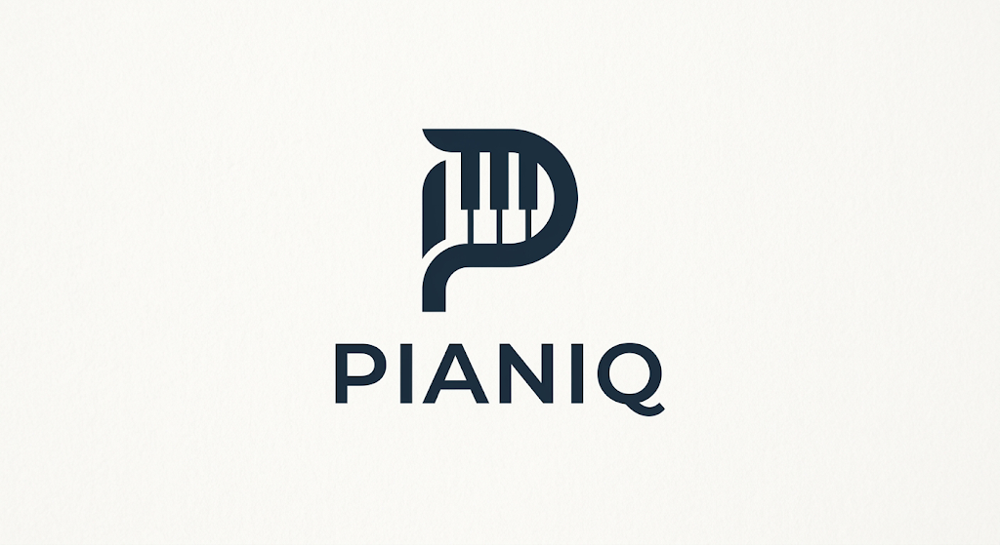
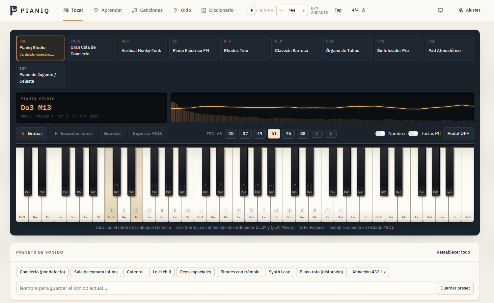
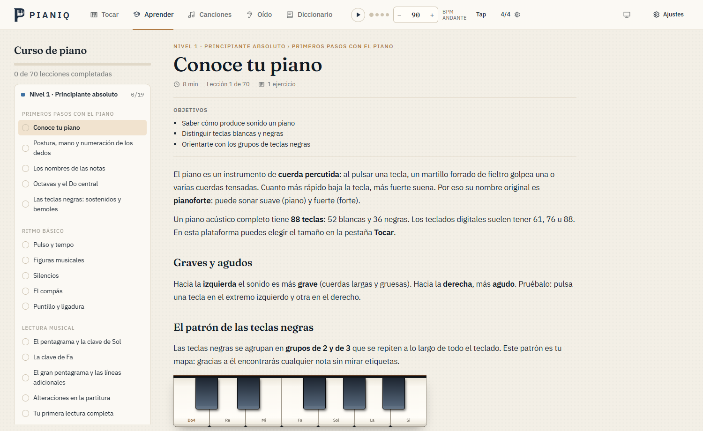
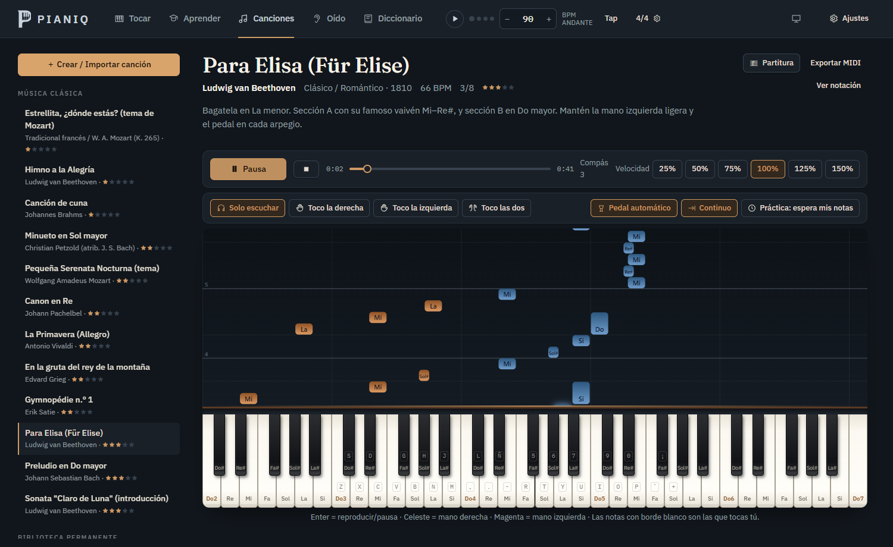

<p align="center">
  
</p>

<p align="center">
  <b>Toca, aprende y crea al piano desde el navegador.</b><br/>
  Un piano de cola real con sonido a tu medida, un curso completo de cero a avanzado<br/>
  y una biblioteca de obras para escuchar, leer y practicar.
</p>

---



## Qué hay dentro

### Tocar
- **10 modelos de instrumento.** El principal, *Pianiq Studio*, es un piano de cola muestreado nota a nota (Salamander Grand). Además: gran cola de concierto, vertical honky-tonk, piano eléctrico FM, Rhodes, clavecín, órgano, sintetizador, pad y celesta.
- **El sonido se ajusta por completo:**
  - **Afinación:** transposición, octava, afinación fina y La de referencia entre 415 y 466 Hz (por ejemplo 432 o 440).
  - **Envolvente y oscilador:** ADSR y forma de onda del sintetizador.
  - **Filtro y ecualizador:** filtro con resonancia y EQ de tres bandas.
  - **Efectos:** reverb, delay, chorus, phaser, trémolo, vibrato y distorsión.
  - **Salida:** panorama y amplitud estéreo.
- **Presets** de fábrica y propios.
- **Metrónomo** con compases de 2/4 a 12/8, subdivisiones, *tap tempo* y acento.
- **Grabadora** con reproducción, guardado y exportación a MIDI.
- **Formas de tocar:** ratón o pantalla táctil (la fuerza depende de dónde pulses la tecla), teclado del ordenador o un **teclado MIDI** con pedal.

### Aprender


Curso de **4 niveles, 70 lecciones y 98 ejercicios interactivos**, sin saltos: desde conocer el teclado y la postura hasta modos, voicings de jazz, polirritmias, improvisación e interpretación. Cada ejercicio muestra el pentagrama y la digitación, comprueba lo que tocas y cuenta los errores. El progreso se guarda solo.

### Canciones


- **30 obras clásicas a dos manos**, muchas completas: Chopin, Debussy, Beethoven (la *Claro de Luna* entera), Mozart, Bach, Satie, Joplin, Grieg…
- **Cumbia y rock:** composiciones originales al estilo de la cumbia y del rock de los 80.
- **Música de dibujos animados:** 14 obras de dominio público que hicieron famosas los cortos clásicos y *Fantasía*: la *Tocata y fuga* de Bach, la *Marcha nupcial*, *Carmen*, la *Marcha turca*, *Maple Leaf Rag*, la Quinta de Beethoven y más, la mayoría completas.
- **Al reproducir:**
  - cascada de notas;
  - partitura activable (arriba, al lado o en ventana flotante);
  - velocidad del 25 al 150 %;
  - **pedal automático** para que la reproducción suene ligada.
- **Para practicar:** tocar una mano mientras la otra suena, o el **modo práctica**, que espera a que toques la nota correcta.
- **Añadir canciones:**
  - importar archivos **MIDI**;
  - escribir partituras en texto;
  - **convertir audio en notas** con IA (Basic Pitch de Spotify, procesado en tu equipo).
- **Biblioteca permanente** para fijar tus canciones.

### Oído y Diccionario
- Entrenamiento auditivo: notas, intervalos, acordes y dictado melódico.
- Diccionario de 22 tipos de acorde y 16 escalas y modos en las 12 tonalidades, con inversiones.

### Interfaz
- Modo claro, oscuro o **según el sistema** (por defecto).
- Tres tonos de marca: *tinta y latón*, *salvia* y *burdeos*.
- Nombres de notas latinos (Do Re Mi) o anglosajones (C D E).

## Empezar

Necesitas [Node.js](https://nodejs.org) 22.18 o superior (por `node:sqlite` y la ejecución directa de TypeScript).

```bash
npm install
npm run dev
```

Se abre en <http://localhost:5173>. En Windows también puedes hacer doble clic en **`Iniciar Pianiq.bat`**.

La primera vez que eliges el piano de cola hace falta conexión: sus muestras de audio se descargan de `tonejs.github.io`. Mientras tanto suena un piano sintético.

```bash
npm run build     # compila la app en dist/
npm start         # servidor de producción: app + API (http://localhost:3000)
```

## Cuentas de usuario

Pianiq es una plataforma con cuentas: registro, inicio de sesión, recuperación de contraseña por correo, perfil editable (foto, nombre, usuario, correo, nivel y biografía), cambio de contraseña, gestión de sesiones abiertas, exportación de datos y borrado de cuenta. El progreso del curso, las canciones propias, los presets y los ajustes se guardan en la cuenta.

- **Usuario de pruebas** (se crea solo en desarrollo): `admin` / `admin123`, con rol de administrador.
- **Administración** (`/admin`): lista de usuarios, búsqueda, cambio de rol, activar o desactivar cuentas y eliminarlas.
- **Correo:** sin configuración, los correos (bienvenida, recuperación de contraseña…) se guardan en el **buzón de pruebas** (`/dev/buzon`, solo en desarrollo). Para enviarlos de verdad, define las variables SMTP.

La API vive en [`server/`](server): Express, SQLite nativo de Node (`node:sqlite`), contraseñas con scrypt, sesiones en cookie `httpOnly` guardadas en la base de datos, enlaces de recuperación de un solo uso (30 min) y límite de intentos contra fuerza bruta. La base de datos se crea en `server/data/pianiq.db`, fuera del repositorio.

| Variable | Para qué sirve |
|---|---|
| `PORT` | Puerto de `npm start` (por defecto 3000) |
| `PUBLIC_URL` | URL pública, usada en los enlaces de los correos |
| `PIANIQ_DB` | Ruta de la base de datos |
| `SMTP_HOST`, `SMTP_PORT`, `SMTP_SECURE`, `SMTP_USER`, `SMTP_PASS`, `MAIL_FROM` | Envío real de correos |
| `PIANIQ_SEED_ADMIN=1` | Crea `admin` / `admin123` también en producción (no recomendado) |

En producción la cookie de sesión lleva `Secure`, así que hay que servir Pianiq por HTTPS (o `localhost`).

## Atajos

| Acción | Tecla |
|---|---|
| Tocar una octava | `Z S X D C V G B H N J M` |
| Tocar la octava siguiente | `Q 2 W 3 E R 5 T 6 Y 7 U I` |
| Pedal de resonancia | `Espacio` |
| Tocar forte | `Mayús` + tecla |
| Bajar / subir la octava del teclado | `←` `→` |
| Transponer | `↑` `↓` |
| Reproducir / pausar una canción | `Enter` |

## Añadir canciones a la biblioteca

Las obras viven en [`src/data/songs.ts`](src/data/songs.ts) y se escriben en una notación de texto sencilla:

```
E5:s D#5 E5 B4 D5 C5 | A4:e r:s C4:s E4 A4
```

- Cada elemento es `NOTA:DURACIÓN`. Las notas se escriben `C4` (Do central), `F#3`, `Bb2` o `Do4` / `Sib3`.
- Duraciones: `w` redonda, `h` blanca, `q` negra, `e` corchea, `s` semicorchea, `t` tresillo, o un número de negras. Con punto se añade la mitad (`q.`).
- Los acordes se escriben con `+` (`C4+E4+G4:h`) y los silencios con `r`.
- Si omites la duración se repite la anterior; las barras `|` solo sirven para leer mejor.

Desde la app, **Canciones → Crear / Importar** permite escribir, importar MIDI o convertir audio. Con **Fijar en la biblioteca** la canción se guarda en `src/data/library/` y aparece siempre (requiere `npm run dev`). Esa carpeta está fuera del repositorio porque suele contener música con derechos de autor.

## Cómo está hecho

| Parte | Tecnología |
|---|---|
| Interfaz | React 19 + TypeScript, Vite |
| Audio | [Tone.js](https://tonejs.github.io) con una cadena de efectos que solo conecta lo que está en uso |
| Piano de cola | Salamander Grand Piano (CC-BY, Alexander Holm) |
| MIDI | Web MIDI API y [@tonejs/midi](https://github.com/Tonejs/Midi) |
| Audio → notas | [Basic Pitch](https://github.com/spotify/basic-pitch-ts) (Spotify) con TensorFlow.js, cargado bajo demanda |
| Servidor | Express + SQLite nativo de Node (`node:sqlite`), scrypt, sesiones con cookie `httpOnly` |
| Estado | Zustand, sincronizado con la cuenta del usuario |
| Tipografía | Fraunces, IBM Plex Sans e IBM Plex Mono (incluidas en el proyecto) |

```
server/           API: cuentas, sesiones, perfiles, datos del usuario y correo
src/
├── audio/        motor de sonido, instrumentos, reproductor y entradas (ratón, teclado, MIDI)
├── components/   teclado, cascada, partitura, pentagrama, controles y marca
├── data/         lecciones del curso, obras clásicas y biblioteca personal
├── lib/          teoría musical, notación de texto, MIDI y conversión de audio
├── pages/        Tocar, Aprender, Canciones, Oído, Diccionario, acceso, perfil y administración
└── state/        ajustes, progreso y canciones del usuario
```

## Créditos

- Muestras de piano: *Salamander Grand Piano* de Alexander Holm (CC-BY 3.0).
- Transcripción de audio: *Basic Pitch* de Spotify (Apache 2.0).
- Las obras clásicas incluidas son de dominio público; salvo donde se indica, los arreglos son propios.
- Del [Mutopia Project](https://www.mutopiaproject.org), convertidas de MIDI en `src/data/pd-midi/`:
  - *The Entertainer* (Scott Joplin), edición original de 1902, dominio público.
  - *Sinfonía n.º 5, I. Allegro con brio* (Beethoven), dominio público; reducción a piano propia a partir de la partitura orquestal.
  - *El Danubio azul* (Strauss II), arreglo para piano de N. Kouremenos, [CC BY-SA 4.0](https://creativecommons.org/licenses/by-sa/4.0/). La conversión se distribuye bajo la misma licencia.
  - Dominio público: *Rondo alla turca* (Mozart), *Maple Leaf Rag* (Joplin), *The Stars and Stripes Forever* (Sousa), *Tocata y fuga en re menor* (Bach) y *En la gruta del rey de la montaña* en la versión para piano de Grieg.
  - *Marcha nupcial* (Mendelssohn), arreglo para órgano de Théodore Dubois, [CC BY-SA 4.0](https://creativecommons.org/licenses/by-sa/4.0/).
  - *Carmen: preludio* (Bizet), versión para piano, [CC BY-SA 2.5](https://creativecommons.org/licenses/by-sa/2.5/).
  - Clásicas completas, dominio público: Chopin (*Vals del minuto*, *Gota de agua*, Preludio Op. 28 n.º 4, *Fantasía-Impromptu*), Debussy (*Claro de luna*, *Arabesca n.º 1*), Beethoven (*Patética*, I), Bach (*Invención n.º 8*) y Joplin (*Solace*, *The Easy Winners*, *Elite Syncopations*).
  - Clásicas completas con licencia CC BY-SA (se distribuyen bajo la misma licencia): Chopin, Nocturnos Op. 9 n.º 2 (3.0) y n.º 3 (4.0); Beethoven, Sonata *Claro de Luna* completa (2.5); Mozart, Sonata K. 545, I (3.0); Bach, *Invención n.º 1* (3.0); Satie, *Gnossienne n.º 1* (4.0).
- *Cumbia de las teclas*, *Cumbia alegre*, *Himno de estadio* y *Balada eléctrica* son composiciones originales de Pianiq.
